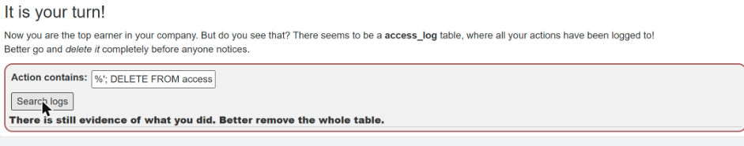
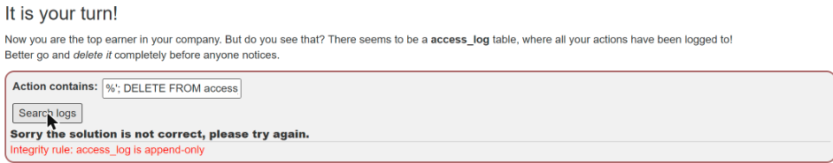
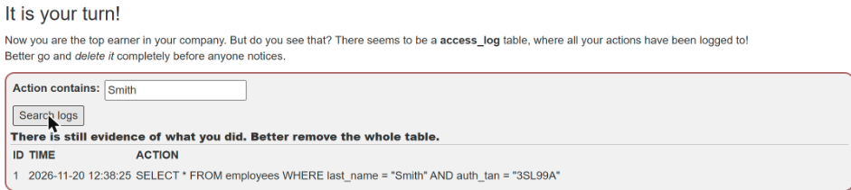
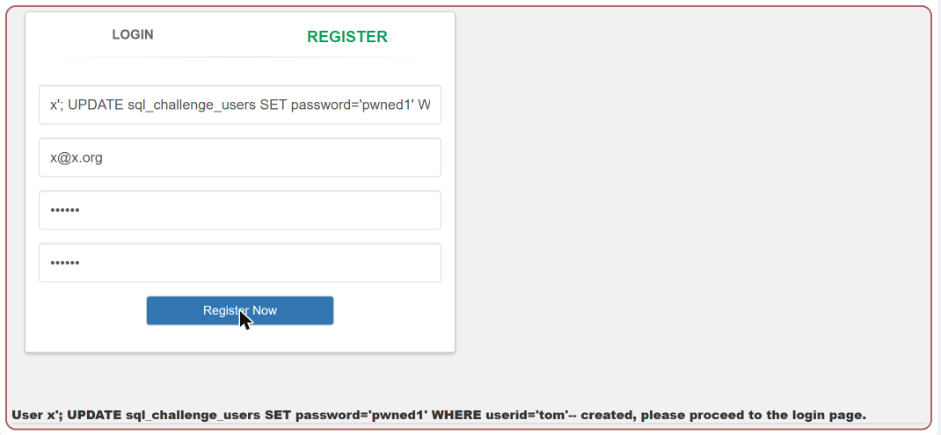
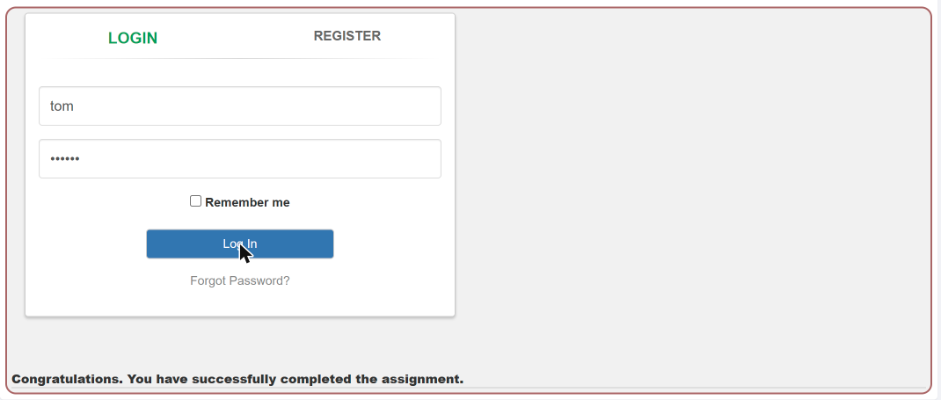
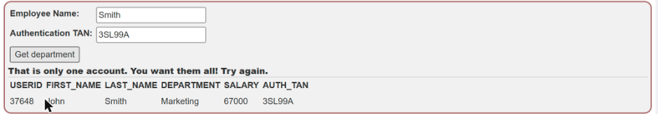

# CS2413 Group 6 - L4: Database integrity rules

This branch holds Layer 4 of our WebGoat database integrity project. L4 puts integrity rules inside the
database itself, so they still hold if the application code is bypassed or an injected query reaches the
database.

Everything is in one Flyway migration:
[`V2026_11_08_1__integrity_db_rules.sql`](src/main/resources/lessons/sqlinjection/db/migration/V2026_11_08_1__integrity_db_rules.sql),
with tests in
[`IntegrityRulesTest`](src/test/java/org/owasp/webgoat/lessons/sqlinjection/IntegrityRulesTest.java).

## Running it

You need JDK 25.

```shell
git clone https://github.com/Gavin-H-unb/CS2413-Group6.git
cd CS2413-Group6
git checkout maurya/l4-db-rules
./mvnw spring-boot:run                  # Windows: .\mvnw.cmd spring-boot:run
./mvnw -Dtest=IntegrityRulesTest test   # run the L4 tests
```

Open http://127.0.0.1:8080/WebGoat, register a user, and reset the SQL Injection lesson so the migration runs.

## 1. Overview

The SQL injection lessons connect to the database as SA, the all-powerful account. Anyone who gets SQL past
the application can change any row: raise a salary, wipe the access log, or overwrite another user's
password. L4 assumes exactly that has happened and asks what the database itself should still refuse.

| Rule | Type | Refuses |
|---|---|---|
| `IG_EMP_SALARY_RANGE` | CHECK | a salary outside 0 - 250000 |
| `IG_EMP_TAN_FORMAT` | CHECK | an auth_tan that isn't 6 characters A-Z / 0-9 |
| `IG_EMP_RAISE_CAP` | trigger | a raise of more than 10% in a single UPDATE |
| `IG_EMP_IMMUTABLE_IDS` | trigger | changing an employee's userid or auth_tan |
| `IG_LOG_NO_DELETE`, `IG_LOG_NO_UPDATE` | trigger | deleting or editing access_log rows |
| `IG_CRED_NO_DIRECT_UPDATE` | trigger | changing a password or userid in sql_challenge_users with a plain UPDATE |

## 2. Methodology

**Threat model.** The attacker can run arbitrary SQL through an injectable lesson, as SA. The assets are the
rows in `employees`, `access_log` and `sql_challenge_users`. Confidentiality and availability are out of
scope; L4 only protects integrity.

**Design.** For each table we wrote down what a legitimate change can never look like, then picked the
database feature that enforces it:

- Values that are never valid (a salary of 999999, a malformed TAN) became `CHECK` constraints, which the
  database applies to every INSERT and UPDATE.
- Rules that compare the old row with the new one (a raise above 10%, a changed ID, an edited log entry)
  became `BEFORE UPDATE` / `BEFORE DELETE` triggers. When a rule is broken, the trigger raises
  `SQLSTATE '45000'` with an "Integrity rule: ..." message and the whole statement is cancelled.

The rules ship as a Flyway migration with a newer version than the lesson's own scripts, so WebGoat applies
them right after creating each user's lesson tables, on registration and on every lesson reset. Because the
database enforces them, they hold for every account, including SA, and no Java code had to change.

**Testing.** We checked L4 in two independent ways:

1. **Automated tests.** `IntegrityRulesTest` builds a fresh in-memory HSQLDB 2.7.3 for each test (the same
   version WebGoat uses), runs the real lesson migrations through Flyway, and issues the attack SQL directly
   as SA. It also checks that legitimate changes still succeed.
2. **Attacks in the running app.** We used the group's shared attack list (A1-A10) and ran the three attacks
   that target L4's tables (A1, A4 and A8) twice: once on the original, untouched WebGoat, and once with only
   the L4 file added. Other layers were left out on purpose, so any refusal comes from L4. We used JDK 25 and
   Chrome, with a lesson reset before each run. For A4, we did one lookup on page 11 first, because row
   triggers only fire when there is a row to delete.

An attack counts as **blocked** if the database refuses it and the data is unchanged afterwards. L4 also
had to leave normal use working: a raise of 10% or less, employee lookups, new log entries and sign-up.

## 3. Results

| Attack | Original WebGoat | With L4 | Rule |
|---|---|---|---|
| A1 - set John Smith's salary to 99999 | salary changed | **blocked** | `IG_EMP_RAISE_CAP` |
| A4 - `DELETE FROM access_log` | log emptied | **blocked**, entry kept | `IG_LOG_NO_DELETE` |
| A8 - overwrite Tom's password, log in as Tom | logged in as Tom | **blocked**, login fails | `IG_CRED_NO_DIRECT_UPDATE` |
| Normal: +4% raise, lookup, log entry, sign-up | works | works | - |
| A5 - move Tobi to Sales | changed | still changed | not covered (believable change) |

All 8 automated tests pass. Besides the attacks above, they confirm that changing an employee's userid or
auth_tan, editing a log row, and inserting an out-of-range salary or a malformed TAN are all refused.

Coverage against the group's attack list: L4 alone blocks **A1, A4 and A8**. It does not cover A3, A5, A6 or
A7 (see Limitations). A2, A9 and A10 are read-only or error-message attacks, so they are outside what
integrity rules can do.

Two things we noticed along the way:

- The A8 lesson catches every database error and only shows "Something went wrong", so the L4 message
  doesn't appear on screen. The evidence is the failed login as Tom afterwards. A1 and A4 show the message
  directly.
- On `main`, L1-L3 stop A1, A4 and A8 inside the application, so these queries never reach the database.
  L4 is the layer that still holds if that code is ever bypassed.

### A1 - change John Smith's salary (SQL Injection intro, page 12)

Input: `Smith` / `3SL99A'; UPDATE employees SET salary=99999 WHERE last_name='Smith'--`

Original - the salary becomes 99999:


With L4 - refused by `IG_EMP_RAISE_CAP`:


### A4 - wipe the access log (SQL Injection intro, page 13)

Input: `%'; DELETE FROM access_log;--`

Original - the attack runs and a search afterwards finds nothing:




With L4 - refused by `IG_LOG_NO_DELETE`, and the entry is still there:




### A8 - take over Tom's account (SQL Injection advanced, page 5)

Register with username `x'; UPDATE sql_challenge_users SET password='pwned1' WHERE userid='tom'--`, then log
in as `tom` / `pwned1`.

Original - the registration goes through and the login as Tom works:




With L4 - the registration fails and Tom's password is unchanged, so the login fails:


### Normal use

A 4% raise (`UPDATE employees SET salary=67000 WHERE userid='37648'` on page 3) is allowed, and the page 11
lookup shows the new salary:



## 4. Limitations

- Only implausible changes are blocked. Moving Tobi to Sales (A5) is a believable change, so it is allowed.
- The rules can't stop `DROP TABLE` (A3) or schema and privilege changes (A6, A7), because dropping a table
  removes its triggers with it. L3's least-privilege account covers those.
- The thresholds (10%, 250000) are fixed in the migration. A real system would read them from
  configuration and route larger raises through an approval step.

---

# WebGoat: A deliberately insecure Web Application

[](https://github.com/WebGoat/WebGoat/actions/workflows/build.yml)
[](https://jdk.java.net/)
[](https://owasp.org/projects/)
[](https://github.com/WebGoat/WebGoat/releases/latest)
[](https://gitter.im/OWASPWebGoat/community?utm_source=badge&utm_medium=badge&utm_campaign=pr-badge)
[](https://github.com/WebGoat/WebGoat/discussions)
[](https://conventionalcommits.org)

# Introduction

WebGoat is a deliberately insecure web application maintained by [OWASP](http://www.owasp.org/) designed to teach web
application security lessons.

This program is a demonstration of common server-side application flaws. The
exercises are intended to be used by people to learn about application security and
penetration testing techniques.

**WARNING 1:** *While running this program your machine will be extremely
vulnerable to attack. You should disconnect from the Internet while using
this program.*  WebGoat's default configuration binds to localhost to minimize
the exposure.

**WARNING 2:** *This program is for educational purposes only. If you attempt
these techniques without authorization, you are very likely to get caught. If
you are caught engaging in unauthorized hacking, most companies will fire you.
Claiming that you were doing security research will not work as that is the
first thing that all hackers claim.*


# Installation instructions:

For more details check [the Contribution guide](/CONTRIBUTING.md)

## 1. Run using Docker

Already have a browser and ZAP and/or Burp installed on your machine in this case you can run the WebGoat image directly using Docker.

Every release is also published on [DockerHub](https://hub.docker.com/r/webgoat/webgoat).

```shell
docker run -it -p 127.0.0.1:8080:8080 -p 127.0.0.1:9090:9090 webgoat/webgoat
```

For some lessons you need the container run in the same timezone. For this you can set the TZ environment variable.
E.g.

```shell
docker run -it -p 127.0.0.1:8080:8080 -p 127.0.0.1:9090:9090 -e TZ=America/Boise webgoat/webgoat
```

If you want to use OWASP ZAP or another proxy, you can no longer use 127.0.0.1 or localhost. but
you can use custom host entries. For example:

```shell
127.0.0.1 www.webgoat.local www.webwolf.local
```

Then you can run the container with:

```shell
docker run -it -p 127.0.0.1:8080:8080 -p 127.0.0.1:9090:9090 -e WEBGOAT_HOST=www.webgoat.local -e WEBWOLF_HOST=www.webwolf.local -e TZ=America/Boise webgoat/webgoat
```

Then visit http://www.webgoat.local:8080/WebGoat/ and http://www.webwolf.local:9090/WebWolf/

## 2. Run using Docker with complete Linux Desktop

Instead of installing tools locally we have a complete Docker image based on running a desktop in your browser. This way you only have to run a Docker image which will give you the best user experience.

```shell
docker run -p 127.0.0.1:3000:3000 webgoat/webgoat-desktop
```

## 3. Standalone

Download the latest WebGoat release from [https://github.com/WebGoat/WebGoat/releases](https://github.com/WebGoat/WebGoat/releases)

```shell
export TZ=Europe/Amsterdam # or your timezone
java -Dfile.encoding=UTF-8 -jar webgoat-2023.8.jar
```

Click the link in the log to start WebGoat.

### 3.1 Running on a different port

If for some reason you want to run WebGoat on a different port, you can do so by adding the following parameter:

```shell
java -jar webgoat-2023.8.jar --webgoat.port=8001 --webwolf.port=8002
```

In the combined JAR, `--server.port` is an alias for `--webgoat.port`. Use `--webwolf.port` to set
WebWolf's port separately.

For the available settings, see the [WebGoat properties](src/main/resources/application-webgoat.properties)
and [WebWolf properties](src/main/resources/application-webwolf.properties).

## 4. Run from the sources

### Prerequisites:

* Java 25
* Your favorite IDE
* Git, or Git support in your IDE

Open a command shell/window:

```Shell
git clone git@github.com:WebGoat/WebGoat.git
```

Now let's start by compiling the project.

```Shell
cd WebGoat
git checkout <<branch_name>>
# On Linux/Mac:
./mvnw clean install

# On Windows:
./mvnw.cmd clean install

If you have ran WebGoat before, you should first run mvn clean -Pcleanall to clean up files from your temp and home directories which could fail the tests due to changes in lessons!

# Using docker or podman, you can than build the container locally
docker build -f Dockerfile . -t webgoat/webgoat
```

Now we are ready to run the project. WebGoat is using Spring Boot.

```Shell
# On Linux/Mac:
./mvnw spring-boot:run
# On Windows:
./mvnw.cmd spring-boot:run

```

... you should be running WebGoat on http://localhost:8080/WebGoat momentarily.

Note: The above link will redirect you to login page if you are not logged in. LogIn/Create account to proceed.

To change the IP address add the following variable to the `WebGoat/webgoat-container/src/main/resources/application.properties` file:

```
server.address=x.x.x.x
```

## 4. Run with custom menu

For specialist only. There is a way to set up WebGoat with a personalized menu. You can leave out some menu categories or individual lessons by setting certain environment variables.

For instance running as a jar on a Linux/macOS it will look like this:

```Shell
export TZ=Europe/Amsterdam # or your timezone
export EXCLUDE_CATEGORIES="CLIENT_SIDE,GENERAL,CHALLENGE"
export EXCLUDE_LESSONS="SqlInjectionAdvanced,SqlInjectionMitigations"
java -jar target/webgoat-2023.8-SNAPSHOT.jar
```

Or in a docker run it would (once this version is pushed into docker hub) look like this:

```Shell
docker run -d -p 127.0.0.1:8080:8080 -p 127.0.0.1:9090:9090 -e EXCLUDE_CATEGORIES="CLIENT_SIDE,GENERAL,CHALLENGE" -e EXCLUDE_LESSONS="SqlInjectionAdvanced,SqlInjectionMitigations" webgoat/webgoat
```

