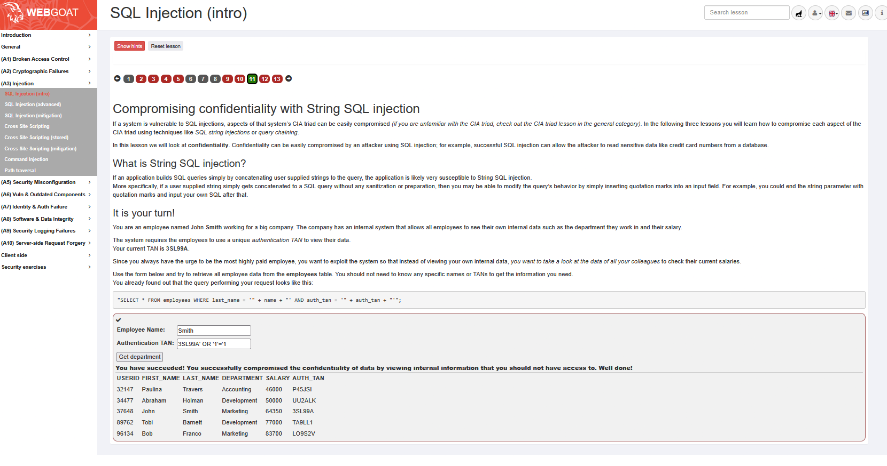
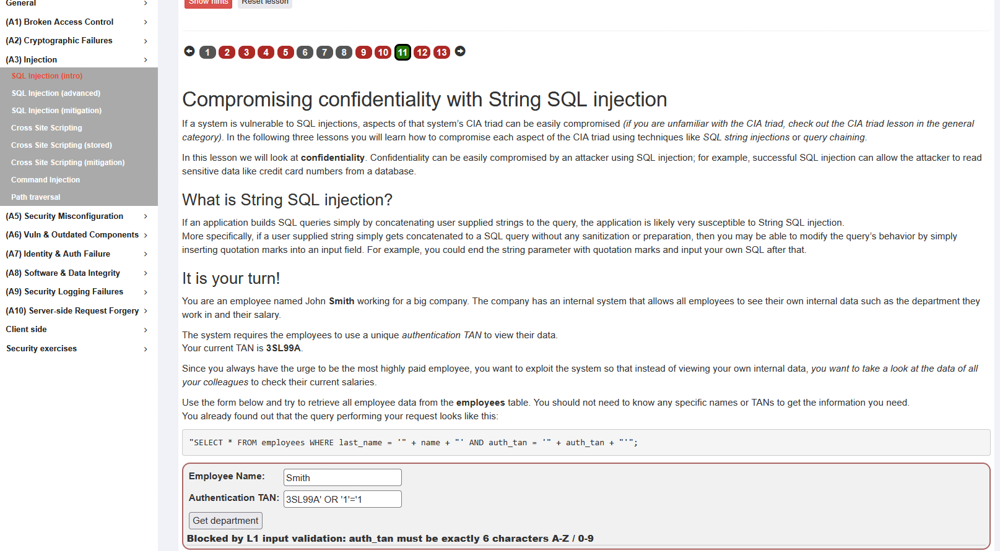
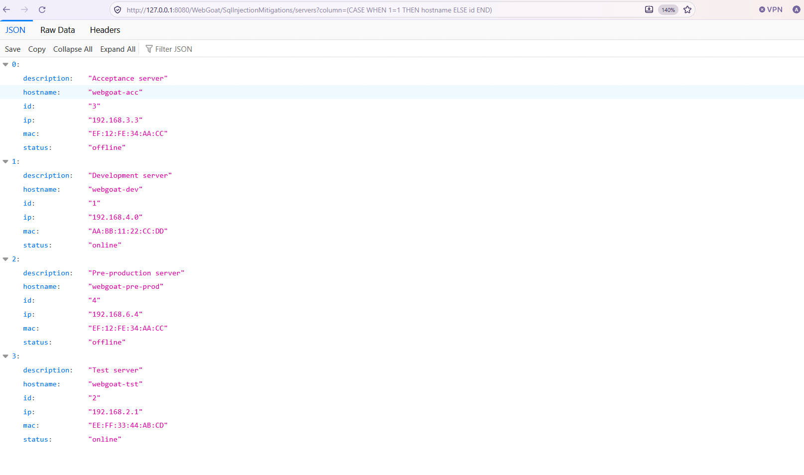
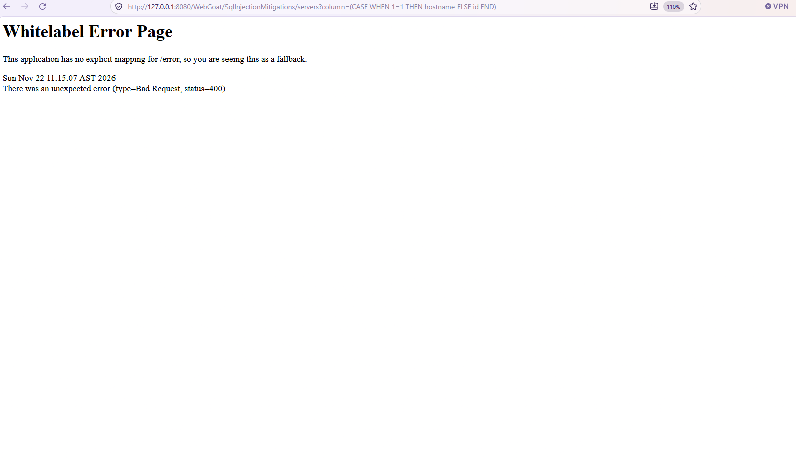
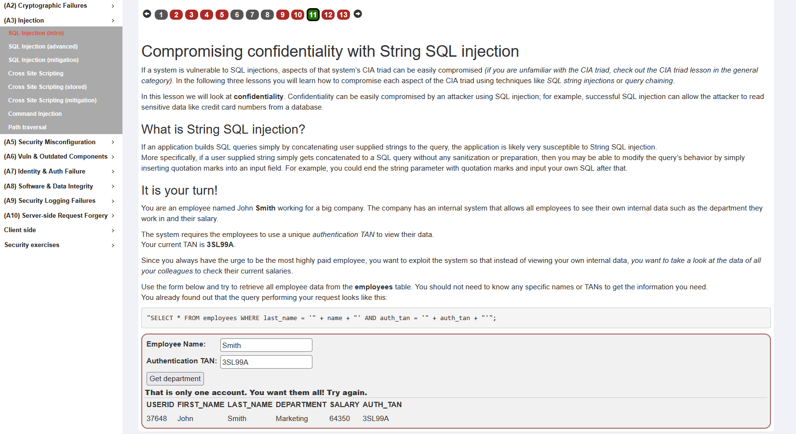
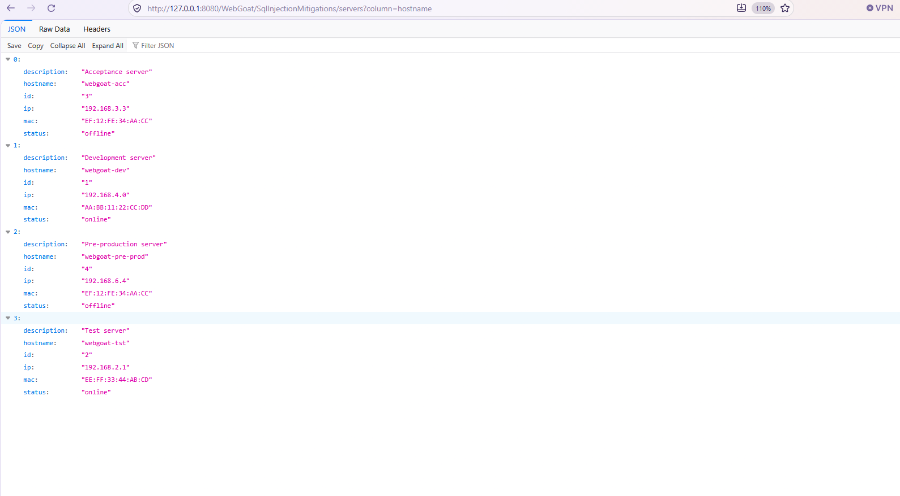

# CS2413 Group 6 - L1: Allowlist input validation

This branch holds Layer 1 of our WebGoat database integrity project. L1 is the outermost defense: a
servlet filter that checks every request against an allowlist and rejects malformed input *before* it can
reach any SQL-injection lesson, so a malicious payload never gets the chance to run.

Everything is in one new file:
[`InputValidationFilter.java`](src/main/java/org/owasp/webgoat/lessons/sqlinjection/validation/InputValidationFilter.java).
Spring registers it automatically (`@Component`) and runs it in front of the lesson endpoints, so no
existing file has to change.

## Rules

The filter matches each parameter against the narrowest format a legitimate value can have. Anything that
does not match is rejected with a clear message.

| Parameter | Must match | Refuses |
|---|---|---|
| `auth_tan` | exactly 6 characters `A-Z` / `0-9` | `3SL99A' OR '1'='1` and any quoted payload |
| `name` | 1-20 letters, space, `.` `'` `-` | overly long or symbol-laden names |
| `action_string` | letters, digits and ` _ . @ : / -` | quotes, semicolons, comment markers |
| `username_reg` | 3-30 of `A-Z 0-9 _ . -` | `x'; UPDATE ...` in registration |
| `email_reg` | a valid e-mail shape | injection in the e-mail field |
| `column` (server list) | one of `id, hostname, ip, mac, status, description` | `ORDER BY (CASE WHEN ...)` expressions |

Allowlisting is used instead of blocklisting: rather than trying to ban every bad string (which attackers
slip past with casing, encoding or comments), the filter states exactly what is allowed and rejects the
rest. The `column` rule exists because a sort column cannot be bound by a prepared statement, so it is
validated here.

## Running it

You need JDK 25.

```shell
git clone https://github.com/Gavin-H-unb/CS2413-Group6.git
cd CS2413-Group6
git checkout kabir/11-validation
./mvnw spring-boot:run        # Windows: .\mvnw.cmd spring-boot:run
```

Open http://127.0.0.1:8080/WebGoat, register a user, and reset the SQL Injection lesson so the data loads.

## Before and after

### Confidentiality - read every employee's data (SQL Injection intro, page 11)

Input: `Smith` / `3SL99A' OR '1'='1`

Before - the OR-injection returns all employees:



After - rejected by the `auth_tan` rule:



### ORDER BY injection (SQL Injection mitigation, server list)

Input (browser address bar): `.../SqlInjectionMitigations/servers?column=(CASE WHEN 1=1 THEN hostname ELSE id END)`

Before - the expression runs and the server list is returned:



After - rejected by the `column` rule with HTTP 400:



### Normal use still works

A valid lookup (`Smith` / `3SL99A`) and a valid sort (`column=hostname`) are unaffected:




---

This branch is built on the untouched WebGoat; L1 is the only thing added. Merged with the other layers,
L1 stops bad input at the door while Layers 2-5 defend the application and database behind it.
