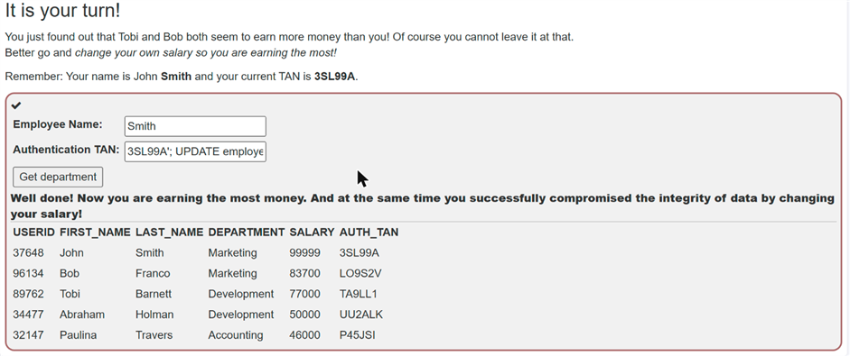
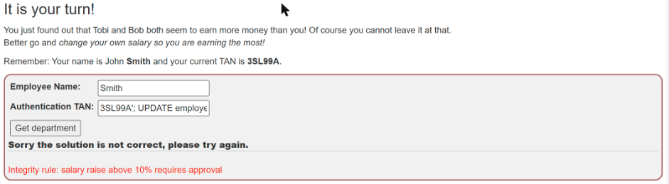
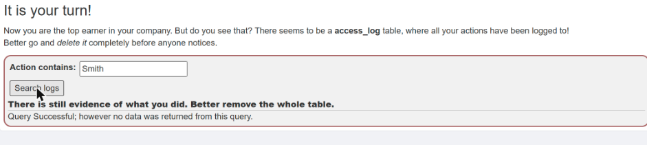
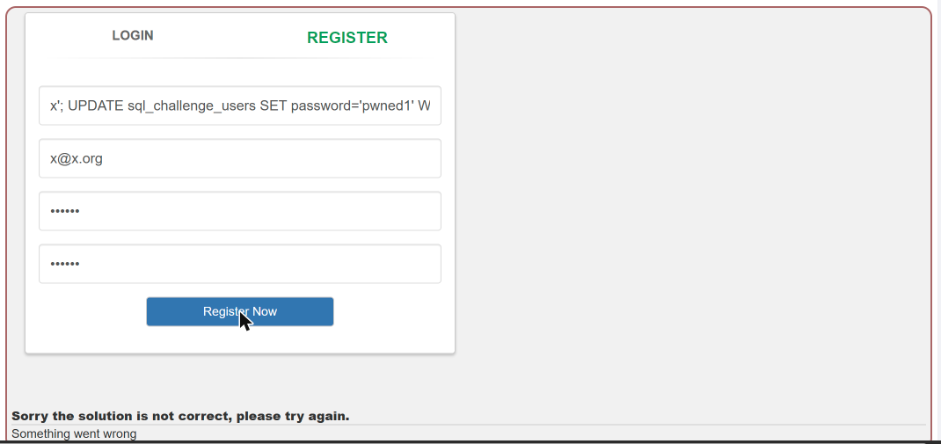
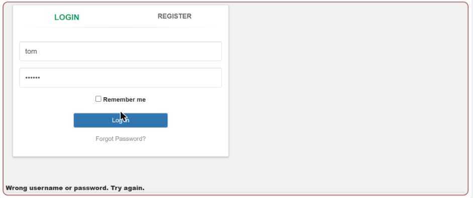
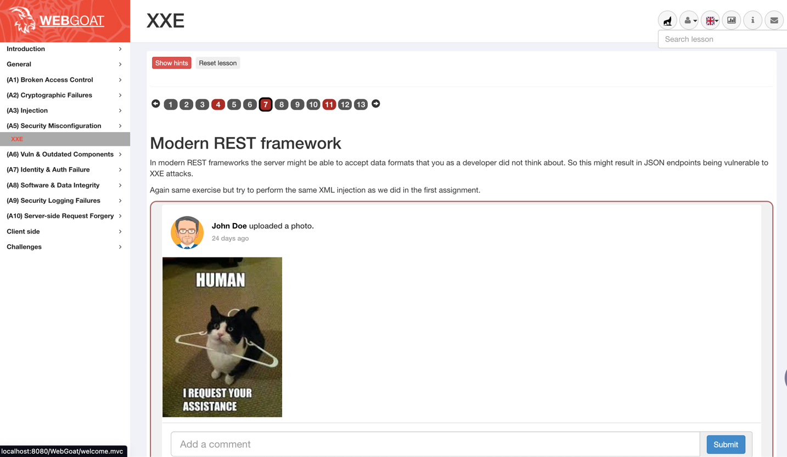

# CS2413 Group 6 - L4: Database integrity rules

This branch holds Layer 4 of our WebGoat database integrity project. L4 puts integrity rules inside the
database itself, so they still hold if the application code is bypassed or an injected query reaches the
database.

Everything is in one Flyway migration:
[`V2026_11_08_1__integrity_db_rules.sql`](src/main/resources/lessons/sqlinjection/db/migration/V2026_11_08_1__integrity_db_rules.sql).
WebGoat runs it whenever a user's SQL injection lesson tables are created or reset.

## Rules

| Rule | Type | Refuses |
|---|---|---|
| `IG_EMP_SALARY_RANGE` | CHECK | a salary outside 0 - 250000 |
| `IG_EMP_TAN_FORMAT` | CHECK | an auth_tan that isn't 6 characters A-Z / 0-9 |
| `IG_EMP_RAISE_CAP` | trigger | a raise of more than 10% in a single UPDATE |
| `IG_EMP_IMMUTABLE_IDS` | trigger | changing an employee's userid or auth_tan |
| `IG_LOG_NO_DELETE`, `IG_LOG_NO_UPDATE` | trigger | deleting or editing access_log rows |
| `IG_CRED_NO_DIRECT_UPDATE` | trigger | changing a password or userid in sql_challenge_users with a plain UPDATE |

The triggers run before the change is saved and raise `SQLSTATE '45000'` with an "Integrity rule: ..."
message, which cancels the whole statement. Since the database enforces them, they apply to every account,
including the SA account the lessons connect with.

## Running it

You need JDK 25.

```shell
git clone https://github.com/Gavin-H-unb/CS2413-Group6.git
cd CS2413-Group6
git checkout maurya/l4-db-rules
./mvnw spring-boot:run        # Windows: .\mvnw.cmd spring-boot:run
```

Open http://127.0.0.1:8080/WebGoat, register a user, and reset the SQL Injection lesson so the migration runs.

This branch also contains L2 and L3, which stop A1, A4 and A8 in the application before they reach the
database. The screenshots below were taken on the original WebGoat with only the L4 file added, so L4 is
the only thing in the way.

## Before and after

### A1 - change John Smith's salary (SQL Injection intro, page 12)

Input: `Smith` / `3SL99A'; UPDATE employees SET salary=99999 WHERE last_name='Smith'--`

Before - the salary becomes 99999:



After - refused by `IG_EMP_RAISE_CAP`:



### A4 - wipe the access log (SQL Injection intro, page 13)

Input: `%'; DELETE FROM access_log;--`. One lookup was done on page 11 first so the log has an entry.

Before - the attack runs and a search afterwards finds nothing:




After - refused by `IG_LOG_NO_DELETE`, and the entry is still there:


### A8 - take over Tom's account (SQL Injection advanced, page 5)

Register with username `x'; UPDATE sql_challenge_users SET password='pwned1' WHERE userid='tom'--`, then log
in as `tom` / `pwned1`.

Before - the registration goes through and the login as Tom works:


After - the registration fails (this lesson hides database errors behind "Something went wrong") and Tom's
password is unchanged, so the login fails:




### Normal use still works

A 4% raise (`UPDATE employees SET salary=67000 WHERE userid='37648'` on page 3) is allowed, and the page 11
lookup still shows the new salary:


## Limitations

- Only implausible changes are blocked. Moving Tobi to Sales (A5) is a believable change, so it is allowed.
- These rules can't stop `DROP TABLE` (A3) or schema and privilege changes (A6, A7). L3's least-privilege
  account covers those.

---

# WebGoat: A deliberately insecure Web Application

[](https://github.com/WebGoat/WebGoat/actions/workflows/build.yml)
[](https://jdk.java.net/)
[](https://owasp.org/projects/)
[](https://github.com/WebGoat/WebGoat/releases/latest)
[](https://gitter.im/OWASPWebGoat/community?utm_source=badge&utm_medium=badge&utm_campaign=pr-badge)
[](https://github.com/WebGoat/WebGoat/discussions)
[](https://conventionalcommits.org)

# Introduction

WebGoat is a deliberately insecure web application maintained by [OWASP](http://www.owasp.org/) designed to teach web
application security lessons.

This program is a demonstration of common server-side application flaws. The
exercises are intended to be used by people to learn about application security and
penetration testing techniques.

**WARNING 1:** *While running this program your machine will be extremely
vulnerable to attack. You should disconnect from the Internet while using
this program.*  WebGoat's default configuration binds to localhost to minimize
the exposure.

**WARNING 2:** *This program is for educational purposes only. If you attempt
these techniques without authorization, you are very likely to get caught. If
you are caught engaging in unauthorized hacking, most companies will fire you.
Claiming that you were doing security research will not work as that is the
first thing that all hackers claim.*



# Installation instructions:

For more details check [the Contribution guide](/CONTRIBUTING.md)

## 1. Run using Docker

Already have a browser and ZAP and/or Burp installed on your machine in this case you can run the WebGoat image directly using Docker.

Every release is also published on [DockerHub](https://hub.docker.com/r/webgoat/webgoat).

```shell
docker run -it -p 127.0.0.1:8080:8080 -p 127.0.0.1:9090:9090 webgoat/webgoat
```

For some lessons you need the container run in the same timezone. For this you can set the TZ environment variable.
E.g.

```shell
docker run -it -p 127.0.0.1:8080:8080 -p 127.0.0.1:9090:9090 -e TZ=America/Boise webgoat/webgoat
```

If you want to use OWASP ZAP or another proxy, you can no longer use 127.0.0.1 or localhost. but
you can use custom host entries. For example:

```shell
127.0.0.1 www.webgoat.local www.webwolf.local
```

Then you can run the container with:

```shell
docker run -it -p 127.0.0.1:8080:8080 -p 127.0.0.1:9090:9090 -e WEBGOAT_HOST=www.webgoat.local -e WEBWOLF_HOST=www.webwolf.local -e TZ=America/Boise webgoat/webgoat
```

Then visit http://www.webgoat.local:8080/WebGoat/ and http://www.webwolf.local:9090/WebWolf/

## 2. Run using Docker with complete Linux Desktop

Instead of installing tools locally we have a complete Docker image based on running a desktop in your browser. This way you only have to run a Docker image which will give you the best user experience.

```shell
docker run -p 127.0.0.1:3000:3000 webgoat/webgoat-desktop
```

## 3. Standalone

Download the latest WebGoat release from [https://github.com/WebGoat/WebGoat/releases](https://github.com/WebGoat/WebGoat/releases)

```shell
export TZ=Europe/Amsterdam # or your timezone
java -Dfile.encoding=UTF-8 -jar webgoat-2023.8.jar
```

Click the link in the log to start WebGoat.

### 3.1 Running on a different port

If for some reason you want to run WebGoat on a different port, you can do so by adding the following parameter:

```shell
java -jar webgoat-2023.8.jar --webgoat.port=8001 --webwolf.port=8002
```

In the combined JAR, `--server.port` is an alias for `--webgoat.port`. Use `--webwolf.port` to set
WebWolf's port separately.

For the available settings, see the [WebGoat properties](src/main/resources/application-webgoat.properties)
and [WebWolf properties](src/main/resources/application-webwolf.properties).

## 4. Run from the sources

### Prerequisites:

* Java 25
* Your favorite IDE
* Git, or Git support in your IDE

Open a command shell/window:

```Shell
git clone git@github.com:WebGoat/WebGoat.git
```

Now let's start by compiling the project.

```Shell
cd WebGoat
git checkout <<branch_name>>
# On Linux/Mac:
./mvnw clean install

# On Windows:
./mvnw.cmd clean install

If you have ran WebGoat before, you should first run mvn clean -Pcleanall to clean up files from your temp and home directories which could fail the tests due to changes in lessons!

# Using docker or podman, you can than build the container locally
docker build -f Dockerfile . -t webgoat/webgoat
```

Now we are ready to run the project. WebGoat is using Spring Boot.

```Shell
# On Linux/Mac:
./mvnw spring-boot:run
# On Windows:
./mvnw.cmd spring-boot:run

```

... you should be running WebGoat on http://localhost:8080/WebGoat momentarily.

Note: The above link will redirect you to login page if you are not logged in. LogIn/Create account to proceed.

To change the IP address add the following variable to the `WebGoat/webgoat-container/src/main/resources/application.properties` file:

```
server.address=x.x.x.x
```

## 4. Run with custom menu

For specialist only. There is a way to set up WebGoat with a personalized menu. You can leave out some menu categories or individual lessons by setting certain environment variables.

For instance running as a jar on a Linux/macOS it will look like this:

```Shell
export TZ=Europe/Amsterdam # or your timezone
export EXCLUDE_CATEGORIES="CLIENT_SIDE,GENERAL,CHALLENGE"
export EXCLUDE_LESSONS="SqlInjectionAdvanced,SqlInjectionMitigations"
java -jar target/webgoat-2023.8-SNAPSHOT.jar
```

Or in a docker run it would (once this version is pushed into docker hub) look like this:

```Shell
docker run -d -p 127.0.0.1:8080:8080 -p 127.0.0.1:9090:9090 -e EXCLUDE_CATEGORIES="CLIENT_SIDE,GENERAL,CHALLENGE" -e EXCLUDE_LESSONS="SqlInjectionAdvanced,SqlInjectionMitigations" webgoat/webgoat
```

